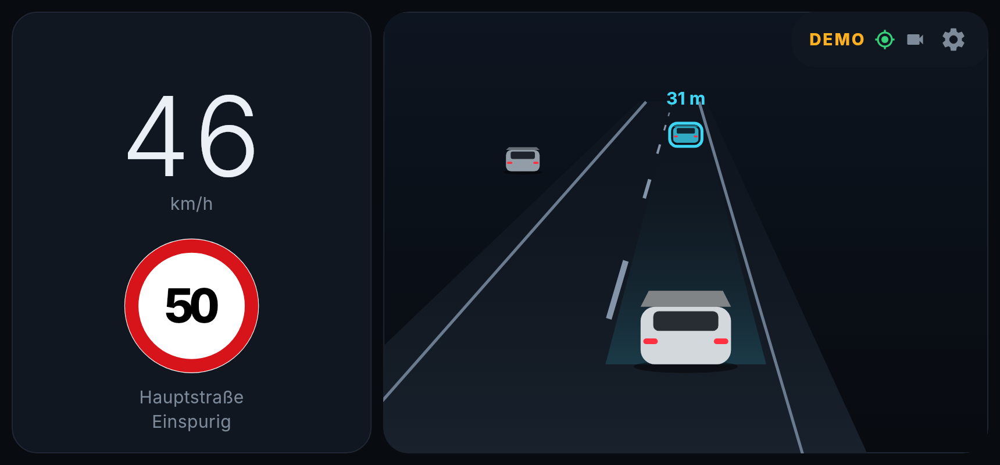
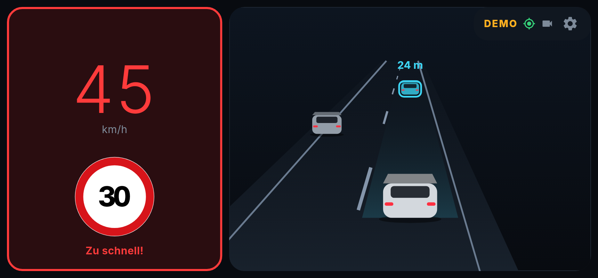
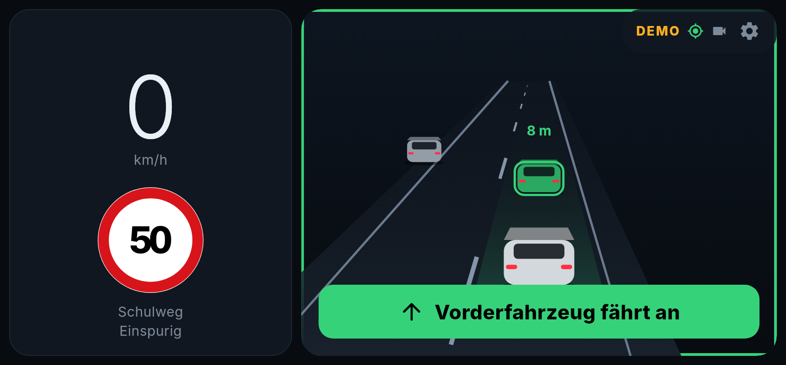
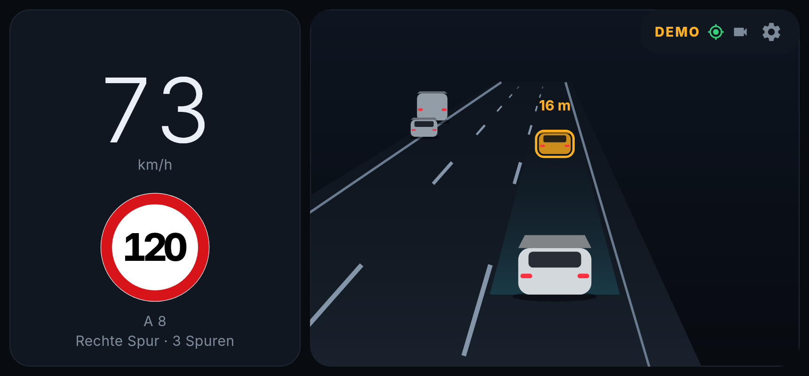
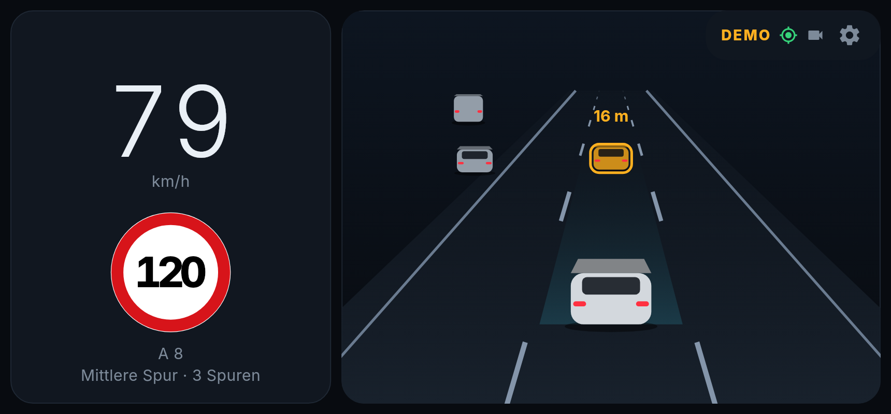

# Street Companion

A driving assistant for your phone. Put the phone in a windshield holder with the rear camera facing the road, and the screen becomes a modern car dashboard:

- **Your speed** from GPS (usually more exact than the car's speedometer, which reads a few km/h high).
- **The speed limit** of the road you are on, from OpenStreetMap, shown as a German road sign.
- **Overspeed warning**: the speed turns red and a voice says "Zu schnell" when you are over the limit plus your tolerance (default +3 km/h).
- **Vehicle detection** with the camera, on the phone itself. Nothing is recorded, stored or uploaded.
- **"Vorderfahrzeug fährt an"**: when you are standing (e.g. at a red light) and the car in front drives off, you get a green banner and a voice hint.
- **Animated traffic view** of the cars around you, with the distance to the car ahead (turns amber when closer than "halber Tacho").
- **Always-on screen** with **automatic brightness** (darker at night and in tunnels).
- **Which lane you are in** (left, middle, right) and **how many lanes** the road has, from the camera's view of the lane markings (solid vs dashed) plus the lane count in OpenStreetMap.
- **Demo mode** to try everything at home without driving.

The app speaks German. It is built with Flutter, so an iPhone version can follow from the same code.

| Driving | Too fast | Car ahead drives off |
| --- | --- | --- |
|  |  |  |

| Motorway, right lane | Middle lane after a lane change |
| --- | --- |
|  |  |

## Install on an Android phone

1. On your phone, open this repository's **Releases** page: `https://github.com/ziczaczony-bot/street-companion/releases/latest`
2. Tap **street-companion.apk** to download it.
3. Open the downloaded file. Android will ask whether your browser (or Files app) may "install unknown apps". Allow it, then tap **Install**.
   (Google Play Protect may warn that the app is unknown. That is normal for apps not from the Play Store: choose "Install anyway".)
4. Open **Street Companion**, read the safety notes, tap **Verstanden**.
5. Allow **location** ("While using the app") and **camera** when asked.

To try it at home: tap the gear icon, switch on **Demo-Modus**, go back. A 70-second scripted drive plays (town, a 30 zone where you are too fast, a red light where the car ahead drives off, a country road).

Each time the code changes, GitHub builds a new APK automatically and puts it on the Releases page. Install the new one over the old one; your settings stay.
Direct link to the newest APK: `https://github.com/ziczaczony-bot/street-companion/releases/latest/download/street-companion.apk`

## Install on an iPhone

See [docs/INSTALL_IPHONE.md](docs/INSTALL_IPHONE.md): free install from a Mac with your Apple ID (the app then runs for 7 days at a time).

## In the car

- Mount the phone firmly, camera facing forward, not blocking your view. Landscape or portrait both work.
- Set everything up **before** you drive. Using the phone while driving is not allowed (§ 23 Abs. 1a StVO).
- The phone gets warm with camera + screen on. Keep it out of direct sun and plug it into a charger for longer trips. If it gets too warm you can switch off the camera in the settings and keep speed and limit.
- If cars are not detected, switch on **Kamerabild klein anzeigen** in the settings to check the camera's view. If the boxes are in the wrong places, try another **Bilddrehung**.
- Lane detection needs visible lane markings. At night, in rain, on worn or missing markings and in road works it may show no lane or the wrong one. The lane count comes from OpenStreetMap and can be missing.
- Speed limits come from OpenStreetMap volunteers. They can be missing or out of date, and temporary limits (road works, electronic signs) are not included. Road signs always win.

## What is not in this first version

Following the feasibility analysis: no traffic-light detection, no recording, no speed-camera warnings (not allowed in Germany, § 23 Abs. 1c StVO), no iPhone App Store / TestFlight build (install from a Mac instead).

## For developers

```
flutter pub get
flutter test                         # logic tests (speed limits, departure alert)
flutter run                          # on a connected phone
flutter test tool/screenshots_test.dart   # re-render docs/*.png from demo mode
```

- `lib/core/lanes.dart` – lane-marking detection (top-hat filter + Hough vote on a 160×120 gray frame, solid vs dashed by painted coverage), lane tracking with lane-change detection, OSM `lanes` per direction.
- `lib/core/` – pure logic: OSM `maxspeed` parsing incl. German implicit limits (`DE:urban`, `DE:zone:30`, …), road matching with heading, overspeed hysteresis, lead-vehicle selection and the departure monitor.
- `lib/services/` – GPS (`geolocator`), Overpass API client with a 700 m road cache, camera + TensorFlow Lite detector (COCO SSD MobileNet v1, ~5 fps to limit heat), voice alerts, auto brightness, demo drive.
- `lib/ui/` – dashboard, animated traffic view, speed sign, settings.

Map data © OpenStreetMap contributors (ODbL). Detection model: TensorFlow `coco_ssd_mobilenet_v1_1.0_quant` (Apache 2.0).
